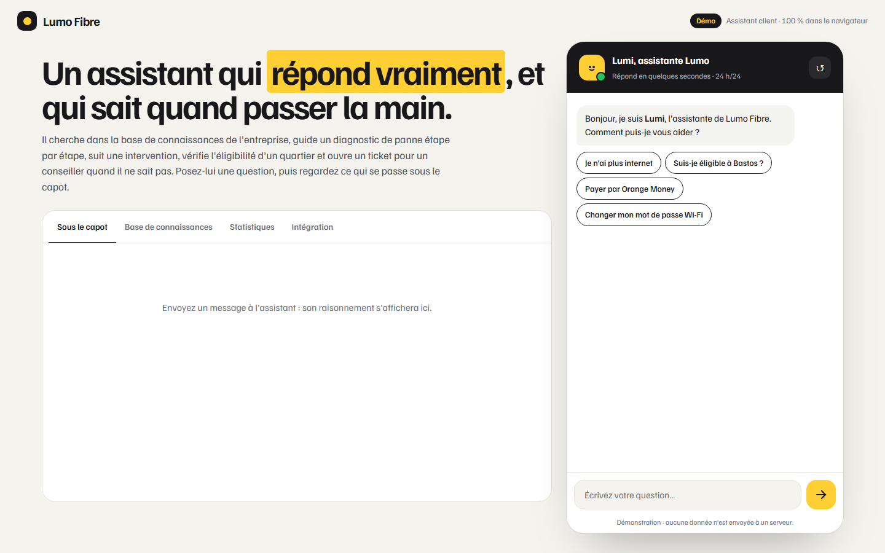
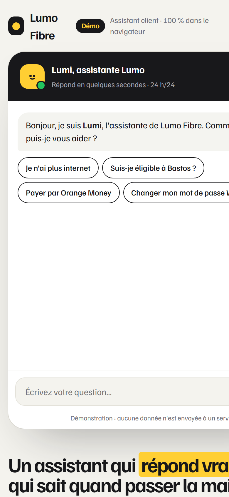

# Lumi, assistante Lumo Fibre

**Assistant IA de support client (chatbot)** — Chatbot de service client pour un fournisseur d'accès fibre : recherche dans la base de connaissances (RAG local, BM25), parcours guidés, escalade vers un conseiller et panneau d'administration. Fonctionne sans API, prêt à brancher un LLM.

**Démo en ligne : [https://lordlennyx.github.io/lumo-assistant/](https://lordlennyx.github.io/lumo-assistant/)**

Spot de présentation (30 s) : [media/spot-30s.mp4](https://lordlennyx.github.io/lumo-assistant/media/spot-30s.mp4)

## Ce que le projet montre

- Compréhension du français : accents, mots vides, racines, synonymes (momo, OM, wifi, débit…), détection d'intention
- Recherche classée BM25 dans les fiches, avec seuil de confiance : l'assistant préfère dire qu'il ne sait pas plutôt qu'inventer
- Parcours guidés : diagnostic de panne par arbre de décision, éligibilité par quartier, suivi d'intervention par numéro de ticket
- Escalade vers un conseiller avec ticket et historique joint, retours utilisateur (utile / pas utile)
- Panneau « Sous le capot » : jetons, intention, scores des fiches, décision
- Base de connaissances éditable (apprise immédiatement), statistiques et questions sans réponse, code d'intégration en une ligne

## Réalisation

- **Stack :** HTML, CSS, JavaScript natif (moteur de recherche maison, sans dépendance)
- **Typographies :** Familjen Grotesk, Martian Mono
- **Évolutions possibles :** génération par LLM (Claude, GPT, Mistral) sur les passages trouvés, WhatsApp Business, back-office multi-agents

| Bureau | Mobile |
|---|---|
|  |  |

---

Client et contenus fictifs, créés pour la démonstration. Conception, design et développement : **Njundiyimun Béchard** — [github.com/LordLennyx](https://github.com/LordLennyx)
